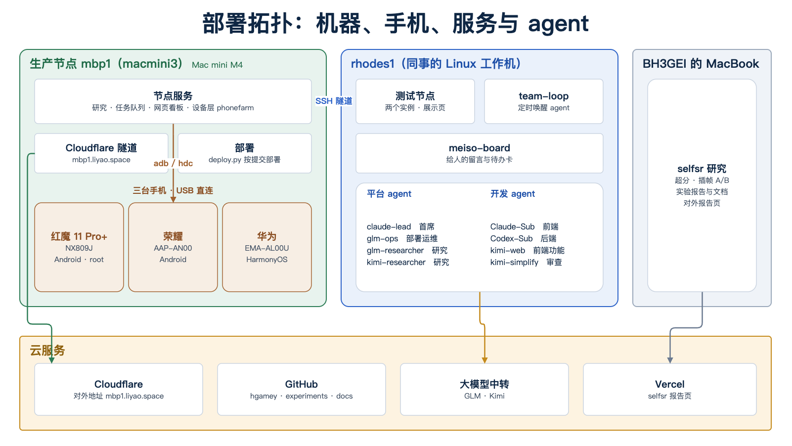

# HGamey 部署现状

本文回答四个问题：手机插在哪；每台电脑跑什么；云上和外部服务各做什么；哪些 agent 在哪里跑、做什么。

- 通用的安装步骤（新建一个节点要准备什么、`deploy.py` 怎么用）见 [HGamey/hgamey 的 README「部署」一节](https://github.com/HGamey/hgamey#部署)。本文只写我们现在这套具体部署。
- 图：[07 系统架构](diagrams/07-architecture.png)（逻辑结构）、[08 部署拓扑](diagrams/08-deployment.png)（机器、手机、服务、agent）。



## 1. 总览

| 机器 | 角色 | 有手机吗 | 跑什么 | 谁管 |
|---|---|---|---|---|
| **macmini3**（对外名 `mbp1`） | **生产节点** | 有，3 台，全部 USB 直连 | 节点服务（含 phonefarm）、Cloudflare 隧道、adb / hdc 服务 | 首席开发者统筹；glm-ops 负责部署和重置 |
| **rhodes1**（同事的 Linux 工作机） | 测试节点 + agent 运行地 + 调度 | 没有 | 两个测试节点实例、展示页、team-loop 定时唤醒、所有 agent 会话、到 mbp1 的 SSH 隧道 | 同事（anantheparty） |
| BH3GEI 的 MacBook | 研究与文档 | 没有 | 手动做 selfsr 研究、写文档、发布对外报告页；不跑节点服务 | BH3GEI |

> `mbp1` 就是 macmini3（隧道名和域名沿用了旧名字），部署配置是 `deploy/mbp1.json`。

## 2. 手机

三台手机都插在 **macmini3** 上，用 USB 直连，没有经过 Hub。每台各占 Mac mini 的一个 USB 控制器；还有一个 USB3 Hub 也接在 macmini3 上，但上面没有设备。

| 平台设备 ID | 型号 | 系统 | 连接与串号 | root | 主要用途 |
|---|---|---|---|---|---|
| `REDMAGIC` | 红魔 11 Pro+（NX809J） | Android 16（SDK 36），RedMagicOS | adb `91253241019A` | 是 | 原神超分 / 插帧（selfsr）、G-FRC+ 对照、waitframe、刷新率研究。有机身风扇（`/sys/kernel/fan`），能停充测功耗 |
| `HONOR` | 荣耀 AAP-AN00 | Android | adb `AVXB6R5C19000481` | 否 | 刷新率档位研究、可调试载体（refbench、重打包 Megacity）、kimi-researcher 的入口验收 |
| `HUAWEI` | 华为 EMA-AL00U | HarmonyOS | hdc `88X9K26901026869`（平台别名 `hdc:88X9K26901026869`） | 否 | 第三台真实任务手机；glm-researcher 在这台上复现过交付 |

- 设备登记是 phonefarm 的稳定设备 ID 加连接别名（`pf-node devices`、`devices-set`、`devices-resolve`）。锁按设备 ID 加，不按串号加。
- 每台手机有自己的锁 lane。全场锁持有时，所有 lane 都被挡住。
- 首页手机格显示每台手机的电量、温度、前台应用和截图。

**手机掉线怎么查**（在 macmini3 上）：

```sh
adb devices -l                                        # 红魔、荣耀
~/hgamey/tools/ohos-sdk/toolchains/hdc list targets -v   # 华为
```

手机重插后不需要重新登记，别名不变。

## 3. 生产节点：macmini3（mbp1）

**硬件与系统**：Mac mini M4（Mac16,10），16 GB 内存，macOS 26.5，系统盘 228 GB（约 75 GB 可用）。局域网地址 `192.168.3.91`，用户 `mac`。

### 3.1 常驻服务（LaunchDaemon，`UserName=mac`，KeepAlive）

| 服务 | 做什么 | 配置与日志 |
|---|---|---|
| `com.hgamey.node` | 运行 `~/hgamey/run_node.sh`：设好环境后 exec `node_service.py --phonefarm … --game-opt-loop … --port 8765`。节点服务再拉起 `phonefarm serve --root ~/hgamey/phonefarm`。进程退出后 launchd 会在 10 s 内重新拉起 | `/Library/LaunchDaemons/com.hgamey.node.plist`；日志 `~/hgamey/.state/node_service.log` |
| `com.hgamey.tunnel` | `cloudflared tunnel run mbp1`（`--protocol http2`），把 `https://mbp1.liyao.space` 转到 `127.0.0.1:8765` | `~/.cloudflared/mbp1.yml`；日志 `~/hgamey/.state/tunnel.log` |

`run_node.sh` 设的环境：
- `PATH`（包含 homebrew）；
- `ANDROID_NDK_HOME=~/hgamey/tools/ndk/android-ndk-r28c`，实验任务现编灰档层要用；
- `PHONEFARM_NODE_TOKEN`，从 `.state/node.token` 读；
- `DEVLOCK_DIR=~/.local/state/phonefarm/locks`。这是持久锁目录。不要改成默认值，默认模式依赖 `/private/tmp`，重启就会被清掉。

节点只监听 `127.0.0.1:8765`，对外只经过隧道。同时最多跑 2 个任务（`max_running: 2`）。

运行中会用到的其他进程：
- adb server：`adb -L tcp:5037`，用的是 homebrew 的 adb；
- hdc server：`~/hgamey/tools/ohos-sdk/toolchains/hdc`，监听 `127.0.0.1:8710`。

### 3.2 目录（`/Users/mac/hgamey`）

| 路径 | 内容 | 部署时 |
|---|---|---|
| `src/` | HGamey/hgamey 的 git 检出，`deploy.py mbp1` 从这里运行 | 会 fetch |
| `releases/<时间>-<哈希>/` | harness-ops 的完整发布；`harness-ops` 是指向当前发布的游标 | 新增，保留最近 5 个 |
| `phonefarm/`、`game_opt_loop/` | 按同一个提交编出来的二进制和资源 | 替换，旧的备份到 `.deploy/backups/` |
| `phonefarm/_jobs/` | 任务产物（实验数据、截图、报告），目前约 1.5 GB | **不碰** |
| `deploy-receipts/` | 每次部署的回执 JSON 和日志 | 新增 |
| `deploy-state/`、`.deploy/` | 部署状态、构建目录、锁、备份 | 不要手工删 |
| `.state/` | `node.token`（管理 token）、各服务日志 | **不碰** |
| `tools/ndk/`、`tools/ohos-sdk/` | NDK r28c、OpenHarmony SDK（hdc） | 不碰 |

`~/.config/hgamey/` 里放网页口令：`dash.pass`（查看）、`steer.pass`（写操作），以及 `remote.operators.json`。

### 3.3 部署

1. **顺序**：main 上的最新提交 CI 两项都绿 → 先部署 rhodes1 并验收 → 立即部署 mbp1，用同一个提交。部署不用等手机空闲。
2. **命令**，在 macmini3 上执行：
   ```sh
   cd ~/hgamey/src && python3 deploy.py mbp1 --ref <提交>
   python3 deploy.py mbp1 --status
   ```
   - 只上 main 的最新提交，先用 `git merge-base --is-ancestor` 确认它比正在跑的版本新，提交号不要手输。
   - 部署要 1–3 分钟（主要是 cargo 编译）。
3. **核对**：回执 `deploy-receipts/<时间>.json` 的 `status: succeeded`，并且 `after` 里 service、phonefarm、game_opt_loop 三个都是同一个提交；首页能看到三台手机。
4. **回滚**：部署上一个提交。

### 3.4 远程登录

- 局域网：`ssh mac@192.168.3.91`。
- 外网：经公司 frp 转发 SSH / VNC，`frpc` 在 macmini3 上常驻。地址、端口和口令见内部记录，不写进公开仓库。

### 3.5 同机的其他服务（与 HGamey 无关，不要动）

macmini3 上还跑着别的项目的 LaunchDaemon / LaunchAgent：
- 多份 frpc 和 cloudflared；
- 家庭自动化（Home Assistant）、本地模型（ollama）、caddy；
- octos 等其他项目的服务。

排查 HGamey 时只看 `com.hgamey.*`，不要按名字 kill 进程。

## 4. rhodes1：测试节点与 agent 运行地

同事的 Linux 工作机（用户 `kamico`），没有插手机。

| 组件 | 做什么 |
|---|---|
| `hgamey-hub.service`（:8765）、`hgamey-node-b.service`（:8766） | systemd **用户**服务，两个测试节点实例。安装根目录 `~/node`，第二个实例的数据在 `/data2/kamico/hgamey-node/`，配置 `deploy/rhodes1.json`。本地启动配置是 `~/node/launch-config.json` |
| 展示页 `/dash/showcase`、`/dash/showcase/command` | 部署在 rhodes1 上，读的是 mbp1 的只读导出（导出不进仓库） |
| team-loop | 本机 cron 每 5 分钟跑一次，脚本在 `/HGamey-dev/HGamey/team-loop/`。agent 会话空闲、并且离上次唤醒满 30 分钟，就叫醒它做下一轮。开发 agent 在自己的笔记目录写 `loop.json`（working / waiting / done）；目录下建 `STOP` 文件，所有唤醒都暂停 |
| `hgamey-mbp1-tunnel` | systemd 用户服务，SSH 隧道 `127.0.0.1:18765 → mbp1:8765`。agent 走这条，因为公网经 Cloudflare 偶尔 502 或超时；人和网页截图仍走 `https://mbp1.liyao.space` |
| 部署检出 `/HGamey-dev/HGamey/deploy-src/hgamey` | rhodes1 的 `deploy.py` 从这里运行 |
| agent 用的 CLI `/HGamey-dev/HGamey/agent-cli/hgamey` | 固定在 mbp1 正在跑的那个提交，保证 agent 的 `pf-node` 和生产节点版本一致 |
| meiso-board（kamico.closure.moe） | 给用户的留言和待办卡，由首席发；用户点卡会叫醒首席 |
| agent | 下一节表里的 agent 都在这台机器上运行 |

## 5. Agent

### 5.1 平台上注册的 agent

这些 agent 各有自己的 token，写入记在自己名下，在 `/dash/` 首页的 Agent 一节可见。

| 名字 | 模型 / 会话 | 职责 | 用哪台手机 |
|---|---|---|---|
| `claude-lead` | Claude（首席开发者） | 定基线和节奏，做宏观验收和生产运维变更（例如锁迁移、维护窗口）；每 4 小时回顾一次，更新恢复记录；唯一给用户发看板消息的身份 | — |
| `glm-ops` | GLM 5.3 | 部署（只上 main 最新提交）、直接重置卡住的队列、每 2 小时写一份摘要、扮演人做端到端验收 | 不直接用 |
| `glm-researcher` | GLM 5.3 | 外部研究员：原神超分 / 插帧（第 7、9 组，60 Hz 掉帧的原因），在华为上复现别人的交付 | 红魔、华为 |
| `kimi-researcher` | Kimi k3.1-pro | 外部研究员：验证一个没见过平台的 agent 只靠 CLI 能否上手；在红魔上复现 glm 的交付 | 荣耀、红魔 |

### 5.2 开发 agent

开发 agent 不在平台上注册，直接改代码推 main。

| 名字 | 模型 / 会话 | 职责 | 现状 |
|---|---|---|---|
| HGamey-Claude-Sub | Claude | 前端：网页看板、指挥中心、展示页 | 进行中 |
| HGamey-Codex-Sub | GPT-6-Astra | 后端：设备锁、任务生命周期、远程控制 | 空闲 |
| kimi-web | Kimi | 前端功能批次（第 1–16 批） | 空闲 |
| kimi-simplify | Kimi | 定期审查代码提交 | 按需 |

## 6. 云服务

| 服务 | 做什么 |
|---|---|
| Cloudflare | 隧道 `mbp1` → `https://mbp1.liyao.space`（只有 `/dash/` 和 API 这一个入口） |
| GitHub · HGamey 组织 | `hgamey`：代码，CI 两项（`tests`、`code-only`），直接推 main。`experiments`：实验脚本，任务按提交号运行。`docs`：报告、计划、图、本文。旧仓库 harness-ops、phonefarm、game_opt_loop、refbench 已归档只读 |
| 大模型中转 api-relay | 给所有 GLM / Kimi agent 提供模型 |
| Vercel | selfsr 对外报告页 `hgamey-selfsr-report.vercel.app`，从 docs 的 `experiments/2026-10-24-selfsr/site/` 手动 `vercel deploy`，没有自动部署 |

## 7. 怎么访问

- **人**：浏览器打开 `https://mbp1.liyao.space/dash/`。查看要查看口令，建任务、指派、给指导要写操作口令。口令向负责人要。
- **agent**：
  ```sh
  export PF_NODE_URL=http://127.0.0.1:18765        # rhodes1 上走 SSH 隧道；别处用 https://mbp1.liyao.space
  export PF_NODE_TOKEN_FILE=<只有自己可读的 token 文件>   # 管理员用 pf-node agents token <名字> 签发
  pf-node node                                      # 读出 node_id，设 PF_NODE_ID
  pf-node checkin                                   # 每轮从这里开始
  ```
  实验用 `pf-node --experiment <experiments 提交> --research <研究ID> --detach experiment <脚本> …` 提交。只指定一台手机的研究，写任务默认只占那台手机。
- **运维**：在 macmini3 上用 `pf-node --admin …`（管理 token 在 `~/hgamey/.state/node.token`），或者直接看 launchd 和日志。

## 8. 出问题时

| 现象 | 先看 | 处理 |
|---|---|---|
| 网页打不开或 502 | 在 macmini3 上 `curl -s -o /dev/null -w '%{http_code}' 127.0.0.1:8765/node`（有任何 HTTP 状态码就说明服务活着）；看 `.state/tunnel.log` | 本地能响应就是隧道或公网的问题，agent 改走 SSH 隧道；本地也不响应就看 `node_service.log`，launchd 会自己拉起 |
| 任务卡住，排队的任务不动 | `pf-node queue`、`pf-node job-events <任务>`（会写在等哪台手机、被谁占着） | `pf-node --admin reset <任务ID> --note <说明>`，一步停任务、放预留；设备状态按实验的恢复表用 adb 还原 |
| 手机显示离线 | `adb devices -l` / `hdc list targets -v` | 重插 USB。别名不用改 |
| 实验改过的设备设置没还原（刷新率、充电、debug.knobs.*） | 实验仓库对应目录的恢复表（例如 [selfsr/HANDOVER.md 第 6 节](https://github.com/HGamey/experiments/blob/main/selfsr/HANDOVER.md)） | 用 adb 手动写回。充电被停：`echo 1 > /sys/class/qcom-battery/charging_enabled`（root） |
| 部署后服务起不来 | `deploy-receipts/` 的最新日志、`node_service.log` | 部署上一个提交回滚；查这次提交有没有删启动参数 |

**不要做**：
- 手工 rsync 覆盖安装目录；
- 删 `releases/`、`deploy-state/`、`_jobs/`、token 文件；
- 把锁快照拷回锁目录；
- 在同一台主机上让不同实例用不同的 `DEVLOCK_DIR`；
- 按名字 kill 进程。macmini3 上还有别的项目在跑。
