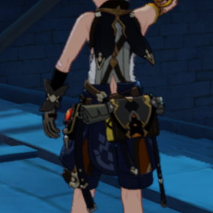
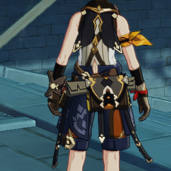

# 自研超分+插帧 · 第 3 步：超分

设备 RedMagic NX809J，`com.miHoYo.Yuanshen` 7.1.0，2026-10-24。游戏内设置未改。
层：phonefarm `knobs/gray/layer/selfsr.*`（commit 2c8d335 / 309ac6a 冻结副本，selfsr 部分相同）。
做法：`debug.knobs.selfsr=<宽>x<高>:<锐化>` 时，层在 `vkCreateSwapchainKHR` 把游戏要的尺寸换成目标尺寸（游戏的帧缓冲不变，只画左上角），
送显前把游戏画的那块拷出来，计算着色器 Lanczos2（4×4，最近 2×2 去振铃）放大到整张，再做 RCAS 对比度自适应锐化，拷回送显。
降分辨率用 Android Game Mode（`cmd game mode custom` + `cmd game set --downscale F`），每臂冷启动生效，收尾 reset 并核对。
测量与第 1、2 步相同；复现：`loop_v1/selfsr/selfsr_ab.py run --a native --b sr:<F>:<宽>x<高>:<锐化> --rounds 6`。

## 两种用法

| | 降分辨率 + 超分（省 GPU） | 满分辨率超分（提画质） |
|---|---|---|
| 臂 | `sr:0.56:2141x969:0.8` | `sr:1:2688x1216:0.8` |
| 游戏实际渲染 | 1505×681（原生的 0.70 倍） | 2141×969（原生，不降） |
| 层输出 | 2141×969，再由 HWC 放大到屏幕 | 2688×1216 = 屏幕原生，HWC 不再放大 |

### A. 降分辨率 + 超分：GPU −19%，帧时 −5%（6 对，p=0.031）

| 指标 | 原生 | 我们 | 差 | 95% 区间 | p |
|---|---|---|---|---|---|
| 每帧 GPU 忙碌 | 28.0 ms | 22.6 ms | **−19.1%** | [−6.6, −4.2] ms | 0.031 |
| p95 帧时 | 36.6 ms | 34.8 ms | **−5.1%** | [−2.5, −1.3] ms | 0.031 |
| 游戏渲染帧率 | 29.49 | 29.85 | +1.2% | [+0.17, +0.56] | 0.031 |
| 上屏帧率 | 29.68 | 29.69 | 0 | | 0.69 |

- 帧率只多 1.2%：测量时手机过热，原神的帧节奏在 30 帧档（每帧 GPU 28 ms > 16.7 ms）；降到 22.6 ms 仍不够跳回 60 帧档。
- 整屏锐度 −24% **不可比**：Game Mode 缩小窗口后，进世界导航的点击落点不同，6 个超分臂的角色/镜头都与原生臂不同（截图可见）。
  画质用同帧离线评估（下）。

### B. 满分辨率超分：锐度 +132%，帧率/帧时无可测代价（6 对，p=0.031）

| 指标 | 原生 | 我们 | 差 | 95% 区间 | p |
|---|---|---|---|---|---|
| 整屏锐度 | 93.8 | 217.3 | **+132%** | [+104, +144] | 0.031 |
| 右上角固定图标区锐度 | 378 | 734 | **+94%** | [+286, +409] | 0.031 |
| 上屏帧率 | 29.68 | 29.65 | −0.1% | [−0.08, +0.03] | 0.38 |
| 游戏渲染帧率 | 29.54 | 29.58 | +0.2% | [−0.29, +0.36] | 0.81 |
| p95 帧时 | 36.9 ms | 36.9 ms | 0 | [−1.2, +1.4] ms | 1.0 |
| SF 丢帧 / 10 s | 0.3 | 4 | | [−0.2, +8.7] | 0.38 |

同场景局部（左原生：游戏 2141×969 + HWC 双线性放大；右：层超分到 2688×1216）：
 

## 同帧离线画质（算子本身）

跨冷启动的整屏 SSIM 被云/时辰/待机动作主导（同为原生的相邻两臂只有 0.49–0.73），判不了画质。
改为同帧比：6 张真机原生帧当真值，缩到 0.7 倍再放大回来（`loop_v1/selfsr/sr_quality.py`，Python 实现与着色器逐项对应）。

| 放大方式 | 对真值 SSIM | 锐度 / 真值 |
|---|---|---|
| 双线性（≈ HWC 现状） | 0.9847 | 0.45× |
| Lanczos2 | 0.9894 | 0.58× |
| **Lanczos2 + RCAS 0.8（我们）** | **0.9847** | **1.01×** |

## 对照第 3 步完成标准

- 「和原生截图比 SSIM 不明显下降、锐度不低于原生」：同帧离线 SSIM 与双线性持平、锐度 1.01×；满分辨率超分真机锐度 +132%。**达成**。
- 「游戏渲染帧率显著提高」：显著但只有 +1.2%。**未达成预期幅度**——原神有帧率档位（30/60），过热时每帧 GPU 28 ms，
  0.7 倍降分辨率省下 19% 仍不够跳档。省下的 GPU 体现在帧时（−5%）上。手机凉下来（60 帧档、GPU 余量小）时可能不同，待测。
- HWC 放大对照（`hwc:0.56`）排队中，用来区分「降分辨率省的」和「我们放大的代价」。
