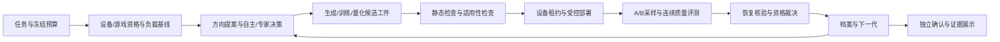

# HGamey 系统交接与迭代计划

核对日期：2026-10-11。此文记录交接审计与交付计划；日常能力现状仍以 [game_opt_loop/STATUS.md](https://github.com/HGamey/game_opt_loop/blob/main/STATUS.md) 为入口。PR 中的实现、离线通过和真机验收分别记录，不互相替代。

## 1. 我们要交付什么

依据 [0917 会议](https://github.com/orgs/HGamey/discussions/1) 与 [0924 会议](https://github.com/orgs/HGamey/discussions/10)，产品是可复用的**媒体算法寻优 harness**。用户给出设备、游戏、目标和预算，系统完成探索或专家引导、候选构建、部署、冻结实验、质量与性能裁决、恢复和证据报告。超分、插帧和神经网络媒体处理是算法路线。

主线平台是已 root 的 Android；Nova 16 的无 root Harmony 触控与性能采集保留为兼容路径。监督数据构建不纳入 Agent，但输入的来源、配对、时间、色彩空间和隔离规则必须可验证。国产模型 API 可连接只是起点，还需在相同预算下验证效果、失败率与成本。

成功的案例应当同时回答：改了什么、实际作用在哪个管线、与什么基线比较、测量是否有效、画面是否合格、收益有多大、代价和未知项是什么、现场是否恢复，以及独立确认能否复现。

专家选择方向，评测端决定证据是否支持收益。生成候选的一方不能在看到候选结果后放宽判据。

## 2. 五个项目在系统中的位置

审计以 GitHub 远端为准：game_opt_loop `d0807b1`、phonefarm `e3b7c35`、refbench `b120ffb`、sr_loop `b3b90db`、独立 knobs `3f812a9`。本地主工作区的未提交 Harmony 修改保留；迭代从远端创建独立 worktree。

| 项目 | 职责与已存在能力 | 当前边界 | 后续角色 |
|---|---|---|---|
| game_opt_loop | GLSL 生成/变异、静态检查、工装评测调度、Pareto、optimize 和只读面板 | 两个入口分离；optimize 不执行 shader 演化；专家方向筛选和统一恢复缺失；模型训练/量化不是当前候选类型 | 任务、方向与 campaign；路线调度；工件与评测契约；证据档案 |
| phonefarm | adb/hdc、触控回放、root 条件化、ftrace/供电采样、系统参数与部分 Vulkan 改写、统计与恢复 | submit 节奏是代理指标；固定 upop 案例未成为动态候选评测入口；必需证据门禁不统一 | 独占设备执行、受控部署、测量、质量、资格与统计裁决、恢复 |
| refbench | 确定性 Android Vulkan 白盒负载、sr_pipeline 外部 SPIR-V 挂点 | 是工装；没有证明任意商业游戏收益；尚无真实同步 LR/HR 导出合同 | 先验证机制/格式/工件适用性、同步配对输入与坏例 |
| knobs | 独立仓库已迁移 | 独立 checkout 不能代表最新灰层能力 | 在 phonefarm/knobs 内维护控制面和 Vulkan 层；不另造编排/统计 |
| sr_loop | 已结项网络结构演化；预算筛选、去重、失败状态与 Pareto 可复用 | 当前树无训练权重/TFLite/配对数组；不能据历史 JSON 直接部署；LR 来自 HR 降采样 | 作为前序证据与设计参考；模型路线在主线工件状态机下重建 |

HGamey/docs 保存交接、架构与展示；HGamey/.github 保存会议与跨仓 issue。

## 3. 对历史案例的准确解释

### 3.1 M2 算子筛选

[M2 条件](https://github.com/HGamey/game_opt_loop/blob/d0807b16ee2df1fb2c58a6a4d8102de4b9f2eee7/evidence/M2_realframes_conditions.md)：NX809J；refbench 测耗时，headless runner 用 19 张原神静态截帧测画质；`--no-llm` 确定性变异；冷机门槛 42°C；USB 充电，功耗不参与。0.264→0.479 ms、34.521→37.796 dB。它证明算子筛选闭环，没有直接证明这些数值是原神管线中的收益。

### 3.2 原神灰层 upop

[09_upop 证据](https://github.com/HGamey/phonefarm/blob/e3b7c35aa21536ed1136301dd96d7d9ff1618bac/knobs/evidence/09_upop/RESULT.md)：同一算法已替换原神 7.1.0 低渲染精度下的放大 draw。5 对 A/B 的 p95 −0.186%、fps +0.154%、放电功耗 +4.069%；机器裁决 `INCONCLUSIVE(无显著变差)`。静态局部截图 MAD 更接近极高参考约 3–4 倍。

“未检测到显著退化”不能推出“零成本”或非劣效。前四对温度缺测；截图不是连续质量或同帧配对证明。现有结果保留为机制与初步案例证据，独立确认前限制结论范围。红魔的挂层结果不能直接外推到一加。

## 4. 需求与验收对应表

| 会议需求/系统缺口 | 交付与验收 | 追踪 |
|---|---|---|
| Harness 全流程与系统交接 | 明确职责、状态、合同、预算和证据级别；1–2 可复核案例 | [系统 epic #11](https://github.com/HGamey/.github/issues/11) |
| 每代专家方向判断，保留无专家能力 | 候选/条件指纹绑定决定，风险/收益/成本与理由持久化；pending 不测；resume 不重复；显式自主模式 | [game_opt_loop #25](https://github.com/HGamey/game_opt_loop/issues/25) |
| 设备可测/可改与结论有效性 | 逐目标必需指标、来源和不确定性；root gate 先于写入；恢复/冷机/基线失败阻断结论 | [#12](https://github.com/HGamey/.github/issues/12) |
| 连续色调/鬼影缺陷 | 对齐序列的空间/色偏/时序残差与坏帧证据；掉帧/错配/未知不得升级 | [#13](https://github.com/HGamey/.github/issues/13) |
| 黑盒游戏 hook 与自主寻优闭合 | 动态候选工件→已验证挂点→命中→A/B质量/性能→恢复→档案 | [#14](https://github.com/HGamey/.github/issues/14) |
| 真实 LR/HR 与插帧数据 | 同步帧/时间/相机/色彩合同；原生输入与降采样/平移素材分开 | [#15](https://github.com/HGamey/.github/issues/15) |
| 模型设计/训练/量化/部署/调优 | 模型工件 schema、阶段 driver、预算与恢复；最小网络整链路 | [#16](https://github.com/HGamey/.github/issues/16) |
| 模型能力沉淀，国内模型运行 | 在冻结预算、输入与 heldout 下比较模型/本地变异器；失败经验进入 harness | [#16](https://github.com/HGamey/.github/issues/16) |
| 停充与条件不能丢失、设备排队 | shader v2 字段贯穿；requested 与 observed 分开；完整实验独占租约 | [#17](https://github.com/HGamey/.github/issues/17) |
| 多轮探索后可信案例/内网展示 | 独立确认集、预冻结非劣效界、只读证据包；不以 p≥α 推出零成本 | [#18](https://github.com/HGamey/.github/issues/18) |

0917 的插帧需求由 #13/#15/#16 覆盖；“探索超过专家的算法”必须在同预算与独立确认中比较，尚未有证据证明。0924 的采购/同型号设备横向比对属于团队资源事项：现有一加仅作为下一轮执行设备，数量/型号/训练机/采购状态仍待团队记录，不把采购计划当可用设备。

## 5. 推进顺序

### 第一批：手机离线期间可交付

1. **campaign 与专家方向决策**：两个入口使用同一状态机，保存失败和负结果；假设备证明 pending/reject 不测、决定与请求绑定、恢复不重复。
2. **实验资格合同**：入口实际消费资格，缺必需指标不 KEEP；显示帧/提交代理、放电/充电、未知/失败分别处理；离线夹具覆盖成功与阻断。
3. **连续序列质量工具**：完整 CLI、配对 manifest、冻结阈值、尺寸安全和异常帧；合成测试只证明机制，真序列验收单独做。

完成这些 PR 后，仍需代码复核、跨仓集成测试和真机验收。不要将 draft PR 写成主线已完成。

### 第二批：主线算法部署

4. shader v2 与租约先接入，消除静默丢失条件与实验互相污染。
5. 把固定 upop 变成受控动态工件入口，再由 optimize 驱动自主 SR，贯穿连续质量和资格裁决。
6. refbench 增加同步 LR/HR/中间帧导出合同；验证实际 FrameGen 输入。

### 第三批：模型与对外成果

7. 模型结构/训练/量化/runtime driver 作为 campaign 可替换阶段接入；不从历史 JSON 假定权重存在。
8. 冻结探索与确认预算、在国内模型与本地变异器间公平比较，沉淀可执行的失败判据。
9. 两个案例经独立确认后生成只读证据包和内网展示；注明收益、代价、未知项和否定结果。

## 6. 下一次一加连接时

见 [一加验收顺序](oneplus-acceptance.md)。当前 `adb devices -l` 为空；没有执行本轮真机实验、真实模型 API 或训练。预算为 **0 API Token** 的编译、单测、夹具与假设备集成测试；付费模型或训练阶段预算另行记录。

系统交付尚未完成：只有在上表各项得到对应范围的实际证据后，才可关闭系统 epic。手机暂离线不会阻止第一批、跨仓合同与动态工件的离线实现。
